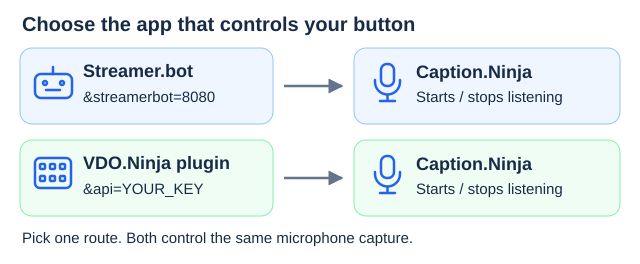
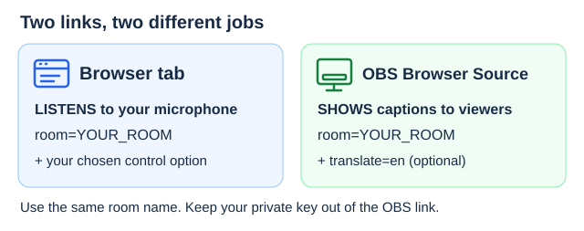
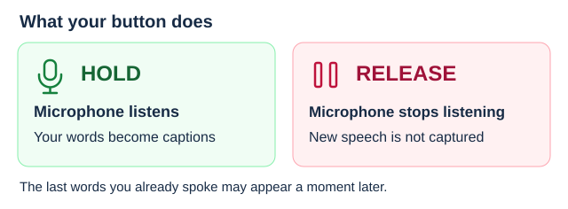
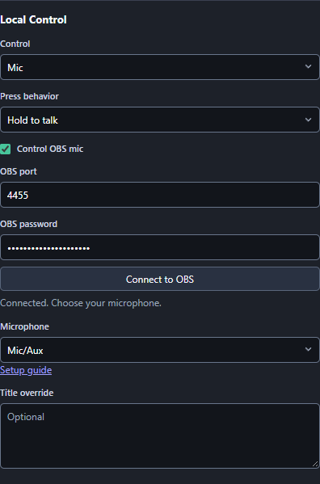
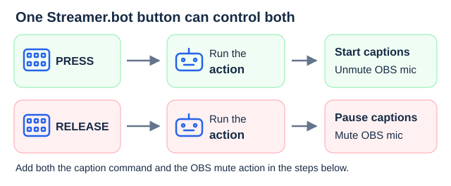
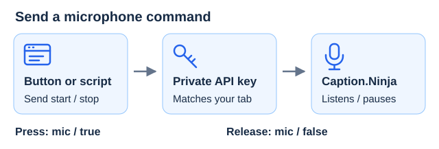

# Hold a button to show captions

Make Caption.Ninja listen while you hold a Stream Deck button, then stop listening when you release it.

Use Chrome or Edge for the listening page. Choose **one** of these two ways to control it:



| What you use | Add to your Caption.Ninja listening link | Go to the instructions |
| --- | --- | --- |
| 🤖 Streamer.bot | `&streamerbot=8080` | [Set up captions + OBS microphone](#streamerbot-setup) |
| 🎛️ VDO.Ninja Stream Deck plugin | `&api=YOUR_KEY` | [Set up captions, with optional OBS mic control](#1-set-up-your-stream-deck-button) |

You do not need both options. If you already use Streamer.bot, start with the **Streamer.bot setup**.

## Contents

- 🤖 [Streamer.bot: captions + OBS microphone](#streamerbot-setup)
- 🎛️ [VDO.Ninja plugin: set up your button](#1-set-up-your-stream-deck-button)
- 🌐 [Open the listening page](#2-open-captionninja)
- 🖥️ [Show captions in OBS](#3-put-the-captions-in-obs)
- 🎙️ [Test hold and release](#4-try-it-before-going-live)
- 🎙️ [Add the OBS microphone without Streamer.bot](#obs-microphone)
- 🔧 [Fix common problems](#if-something-goes-wrong)
- 🔗 [HTTP links and WebSocket commands](#http-links-and-websocket-commands)

## 1. Set up your Stream Deck button

🎛️ **Local Control** → 🎙️ **Mic** → 👆 **Hold to talk**

This method uses the **VDO.Ninja Stream Deck plugin**. You do not need to open a VDO.Ninja call.

1. In the Stream Deck software, drag VDO.Ninja's **Local Control** action onto a button.
2. Set **Control** to **Mic**.
3. Set **Press behavior** to **Hold to talk**.
4. Find **Connection key (API key)**. Copy your existing key. If this is your first setup, click **Generate secure key**, then **Copy key**.

The key is a password for your microphone control. Keep it private. Pages using the same key will respond to the same button.

## 2. Open Caption.Ninja



Copy this address into Chrome or Edge, replacing the two placeholders:

```text
https://caption.ninja/?ver=33&room=YOUR_ROOM&api=YOUR_KEY&lang=de-DE
```

- Replace `YOUR_ROOM` with a name you choose for your captions. Use a long name with letters and numbers, without spaces.
- Replace `YOUR_KEY` with the connection key you copied from Stream Deck. Keep it different from your room name.
- This example listens for German. Use `&lang=en-US` for English or choose another [spoken language](translation-guide.html).

Wait for **API connected** on the page. Listening starts paused. Allow microphone access when the browser asks.

Keep this tab open. You can switch to another window while using the button.

## 3. Put the captions in OBS

🖥️ **OBS Sources** → **＋** → 🌐 **Browser** → 💬 **Captions on your stream**

1. In OBS, click **+** under **Sources**, then choose **Browser**.
2. Name the source **Translated captions**, then click **OK**.
3. Paste the address below into the **URL** box. Replace `YOUR_ROOM` with the same room name as above.
4. Click **OK**, then position the captions in your scene.

```text
https://caption.ninja/overlay?ver=33&room=YOUR_ROOM&translate=en&fromlang=de
```

This example translates German (`fromlang=de`) into English (`translate=en`). Change these codes for other languages, such as `fr` for French or `es` for Spanish. For captions without translation, remove `&translate=en&fromlang=de`.

The spoken language belongs in the listening tab's `lang` setting. The output language belongs in the OBS link's `translate` setting. Without a `lang` setting, the listening page defaults to English.

Keep the two links separate: the browser tab listens to you; the OBS link displays the captions. Only the listening tab needs your private key.

## 4. Try it before going live



1. Hold the Stream Deck button. Wait for the browser's microphone indicator, then say a sentence.
2. Release the button. Say a different sentence. This one should not appear.
3. Hold the button again and say another sentence. Captions should resume.

The last words spoken while holding the button may appear shortly after you release it. Releasing the button does not erase captions already on screen.

To make this same button control your OBS microphone too, follow the optional setup below.

## OBS microphone

Use the VDO.Ninja Stream Deck plugin **0.1.15 or newer** and **OBS Studio 28 or newer**, running on the same computer. This adds OBS microphone control to your existing caption button. No VDO.Ninja call or Streamer.bot is needed.

1. In OBS, open **Tools > WebSocket Server Settings**. Enable the server and keep **Enable Authentication** checked. Open **Show Connect Info**, then note the server port and copy the password.
2. In Stream Deck, select your caption button: **Local Control > Mic > Hold to talk**. Keep it as a standalone button, outside a Multi Action.
3. Enable **Control OBS mic**. Enter the OBS port (usually `4455`) and password, then click **Connect to OBS**.
4. Choose your microphone from the **Microphone** list. Use the same source you normally hear on your stream. Keep the OBS password private.
5. In **OBS > Settings > Audio**, disable **Enable Push-to-Talk** and **Enable Push-to-Mute** for this microphone. The new button replaces the old hotkey. Mute the microphone in OBS's Audio Mixer before testing.
6. Keep the Caption.Ninja listening tab open. Make a short OBS recording: hold the button and speak German, release it and speak again, then hold it for another sentence.
7. Play back the recording. Speech while held should be audible with English captions. Speech after release should be neither audible nor captioned. Words spoken before release may finish translating afterward.



If **Control OBS mic** is missing, [install the newer plugin](https://github.com/steveseguin/vdo-streamdeck/releases/latest). If connection fails, check the OBS port and password. After renaming an OBS source, click **Connect to OBS** and choose it again.

If either control stops responding during a stream, mute the microphone directly in OBS and click **Stop listening** in Caption.Ninja (or close its tab) before reconnecting.

## If something goes wrong

| What you see | What to do |
| --- | --- |
| 🎙️ No captions | Allow microphone access. Check both links use the same room name. Try Chrome or Edge. |
| 🎛️ Button does nothing | For the VDO.Ninja plugin, check the API keys match. For Streamer.bot, check it is connected and both button actions are assigned. |
| 💬 Captions appear twice | Close extra listening tabs. Keep one open for this room. |
| 🔌 Connection drops | Listening pauses. For the API, wait for **API connected**. For Streamer.bot, click **Connect to Streamer.bot**. Then press your button again. |
| 🛑 Need to stop now | Click **Stop listening**, or close the tab. Use this if your Stream Deck disconnects while held. |

Reloading the listening page always starts it paused.

## Streamer.bot setup



**One button controls both your OBS microphone and captions:** hold to speak, release to stop. This setup uses the **Streamer.bot** Stream Deck plugin. You do not need the VDO.Ninja plugin or an API key.

### 1. Connect Streamer.bot to OBS

Open OBS, Streamer.bot, and Chrome or Edge on the same computer. Use Streamer.bot 0.2.5 or newer.

In Streamer.bot, open **Stream Apps → OBS** and check that OBS is connected. If it is not, follow the [OBS connection steps with screenshots](https://docs.streamer.bot/get-started/setup/broadcasters#obs-studio), then return here.

### 2. Connect your Caption.Ninja listening page

1. In **Streamer.bot**, open **Servers/Clients → WebSocket Server**. Set **Address** to `127.0.0.1`, **Port** to `8080`, and **Endpoint** to `/`. Keep your password settings and start the server.
2. In **Chrome or Edge**, open your existing Caption.Ninja listening page. Add `&streamerbot=8080` to its address and reload. Keep your room name and language settings; remove `&api=...` if you added it for the other setup.
3. On that page, enter the **Streamer.bot WebSocket password** if enabled, then click **Connect to Streamer.bot**. Allow local-network access if asked. Wait for **Connected**.

For a new setup, use this address and replace `YOUR_ROOM` with a long room name of your choice, using letters and numbers:

```text
https://caption.ninja/?ver=33&room=YOUR_ROOM&streamerbot=8080
```

Use your Streamer.bot server's port in place of `8080` if it is different. Keep the listening tab open; it starts paused.

**Already have translated captions in OBS? Keep that Browser Source as it is.** Otherwise, [add the caption overlay](#3-put-the-captions-in-obs), using the same room name, then return here. The `streamerbot` setting belongs on the listening page only.

### 3. Create the press action

1. In Streamer.bot, open **Actions & Queues → Queues**. Right-click the queue list, choose **Add**, name it **Caption Mic**, and enable **Blocking**. This keeps press and release in order.
2. Open **Actions & Queues → Actions**. Right-click the action list and choose **Add**. Name it **Captions Press**, select the **Caption Mic** queue, and leave **Concurrent** off.
3. Select **Captions Press**. Right-click its **Sub-Actions** area and choose **Core → C# Code → Execute C# Code**.
4. Replace the editor contents with the code below. Change only `YOUR_ROOM` to the room name in your Caption.Ninja address, keeping the quotes. Save the code.

```csharp
public class CPHInline
{
    public bool Execute()
    {
        CPH.WebsocketBroadcastJson("{\"captionninja\":{\"room\":\"YOUR_ROOM\",\"listening\":true}}");
        return true;
    }
}
```

Now add the microphone control to that same action: right-click **Sub-Actions**, choose **OBS Studio → Sources → Set Source Mute State**, select your OBS connection and microphone source, and set **State** to **Not Muted**.

### 4. Create the release action

1. Right-click the action list and choose **Add** again. Name this action **Captions Release**, select the same **Caption Mic** queue, and leave **Concurrent** off.
2. Select it and add **Core → C# Code → Execute C# Code**, just as above.
3. Replace the editor contents with this code, change `YOUR_ROOM` to the same room name, and save:

```csharp
public class CPHInline
{
    public bool Execute()
    {
        CPH.WebsocketBroadcastJson("{\"captionninja\":{\"room\":\"YOUR_ROOM\",\"listening\":false}}");
        return true;
    }
}
```

Add **OBS Studio → Sources → Set Source Mute State** to this action too. Select the same microphone, but this time set **State** to **Muted**.

Your two actions should now look like this. Do not add delays or other actions to the **Caption Mic** queue.

| Action | Caption code | OBS mic state |
| --- | --- | --- |
| **Captions Press** | `listening` is `true` | **Not Muted** |
| **Captions Release** | `listening` is `false` | **Muted** |

### 5. Set up the Stream Deck button

1. Open the **Stream Deck software** and expand **Streamer.bot** in the action list on the right. If it is missing, [install the Streamer.bot plugin](https://streamdeck.streamer.bot/).
2. Drag its **Action** onto an empty button, then click that button to show its settings below.
3. Select your Streamer.bot instance. Set **Key-Down** to **Captions Press** and **Key-Up** to **Captions Release**. Leave the long-press action empty.

### 6. Switch over and test

1. In **OBS → Settings → Audio**, turn off **Enable Push-to-Talk** and **Enable Push-to-Mute** for this microphone if enabled. The new button replaces those controls. Mute the mic in OBS's Audio Mixer before testing.
2. Keep Streamer.bot and the Caption.Ninja listening tab open. Allow microphone access when the browser asks.
3. Make a short OBS recording. Hold the **new button**, wait for the browser's microphone indicator, and say "Button held". Release it and say "Button released". Hold it again and say "Button held again".
4. Play back the recording. Only the two sentences spoken while holding the button should be heard and captioned. Check that the OBS mic returns to muted when you release.

The last words spoken while held may finish appearing after release. Existing captions stay on screen.

If captions keep listening, check **Key-Up** is assigned to **Captions Release**. If the mic stays silent, check the OBS connection, selected microphone, and old push-to-talk setting. If Caption.Ninja loses its Streamer.bot connection, click **Connect to Streamer.bot** again before pressing the button.

## HTTP links and WebSocket commands



Open the main Caption.Ninja page with `&api=YOUR_KEY`, as in step 2 above. Use the same private key in these links:

| What you want to do | Link |
| --- | --- |
| Start listening | `https://api.vdo.ninja/YOUR_KEY/mic/null/true` |
| Stop listening | `https://api.vdo.ninja/YOUR_KEY/mic/null/false` |
| Switch between listening and paused | `https://api.vdo.ninja/YOUR_KEY/mic/null/toggle` |
| Check whether listening is paused | `https://api.vdo.ninja/YOUR_KEY/mic` |

For hold-to-talk, call **Start listening** on press and **Stop listening** on release.

The response describes whether the microphone is **muted**: `true` means paused; `false` means listening.

WebSocket clients connect to `wss://api.vdo.ninja:443` and send these messages in order:

```json
{"join":"YOUR_KEY"}
{"action":"mic","value":false}
```

The second message stops listening. Use `true` to start or `"toggle"` to switch. Strings `"true"` and `"false"` also work. Leave out `target`, or set it to `null`.

Replies contain `callback`, with the original request fields plus `result`. Caption.Ninja also supports `getDetails`, an empty `getGuestList`, and `details`/`muted` updates for button feedback. Other VDO.Ninja commands are ignored.
