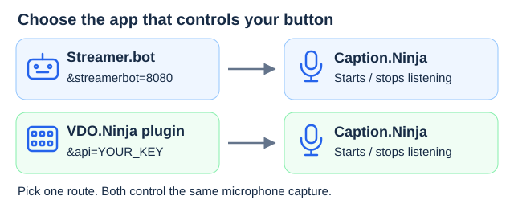
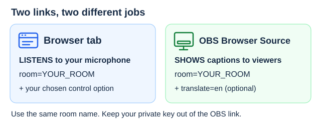
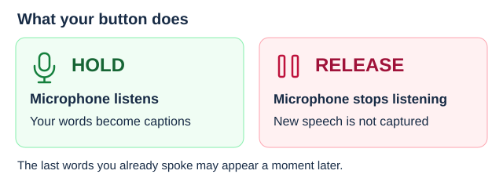
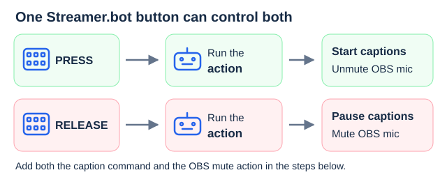
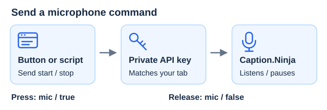

# Hold a button to show captions

Make Caption.Ninja listen while you hold a Stream Deck button, then stop listening when you release it.

Use Chrome or Edge for the listening page. Choose **one** of these two ways to control it:



| What you use | Add to your Caption.Ninja listening link | Go to the instructions |
| --- | --- | --- |
| 🤖 Streamer.bot | `&streamerbot=8080` | [Set up captions + OBS microphone](#streamerbot-setup) |
| 🎛️ VDO.Ninja Stream Deck plugin | `&api=YOUR_KEY` | [Set up the caption button](#1-set-up-your-stream-deck-button) |

You do not need both options. If you already use Streamer.bot, start with the **Streamer.bot setup**.

## Contents

- 🤖 [Streamer.bot: captions + OBS microphone](#streamerbot-setup)
- 🎛️ [VDO.Ninja plugin: set up your button](#1-set-up-your-stream-deck-button)
- 🌐 [Open the listening page](#2-open-captionninja)
- 🖥️ [Show captions in OBS](#3-put-the-captions-in-obs)
- 🎙️ [Test hold and release](#4-try-it-before-going-live)
- 🔧 [Fix common problems](#if-something-goes-wrong)
- 🔗 [HTTP links and WebSocket commands](#http-links-and-websocket-commands)

## 1. Set up your Stream Deck button

🎛️ **Local Control** → 🎙️ **Mic** → 👆 **Hold to talk**

This method uses the **VDO.Ninja Stream Deck plugin**. You do not need to open a VDO.Ninja call.

1. In the Stream Deck software, drag VDO.Ninja's **Local Control** action onto a button.
2. Set **Control** to **Mic**.
3. Set **Press behavior** to **Hold to talk**.
4. Find **Connection key (API key)**. Copy your existing key. If this is your first setup, click **Generate secure key**, then **Copy key**.

The key is a password for your microphone control. Keep it private. Pages using the same key will respond to the same button.

## 2. Open Caption.Ninja



Copy this address into Chrome or Edge, replacing the two placeholders:

```text
https://caption.ninja/?room=YOUR_ROOM&api=YOUR_KEY
```

- Replace `YOUR_ROOM` with a name you choose for your captions. Use a long name with letters and numbers, without spaces.
- Replace `YOUR_KEY` with the connection key you copied from Stream Deck. Keep it different from your room name.

Wait for **API connected** on the page. Listening starts paused. Allow microphone access when the browser asks.

Keep this tab open. You can switch to another window while using the button.

## 3. Put the captions in OBS

🖥️ **OBS Sources** → **＋** → 🌐 **Browser** → 💬 **Captions on your stream**

1. In OBS, click **+** under **Sources**, then choose **Browser**.
2. Name the source **Translated captions**, then click **OK**.
3. Paste the address below into the **URL** box. Replace `YOUR_ROOM` with the same room name as above.
4. Click **OK**, then position the captions in your scene.

```text
https://caption.ninja/overlay?room=YOUR_ROOM&translate=en
```

This example shows English translations. Change `en` to `de` for German, `fr` for French, or `es` for Spanish. For captions without translation, remove `&translate=en`.

Caption.Ninja listens in your browser's language. To choose another spoken language, add `&lang=de-DE` for German or `&lang=en-US` for English to the **Caption.Ninja tab's address**. See the [translation guide](translation-guide.html) for more languages.

Keep the two links separate: the browser tab listens to you; the OBS link displays the captions. Only the listening tab needs your private key.

## 4. Try it before going live



1. Hold the Stream Deck button. Wait for the browser's microphone indicator, then say a sentence.
2. Release the button. Say a different sentence. This one should not appear.
3. Hold the button again and say another sentence. Captions should resume.

The last words spoken while holding the button may appear shortly after you release it. Releasing the button does not erase captions already on screen.

**This button controls Caption.Ninja. It does not automatically mute your microphone in OBS.** To control both together through Streamer.bot, use the optional setup below.

## If something goes wrong

| What you see | What to do |
| --- | --- |
| 🎙️ No captions | Allow microphone access. Check both links use the same room name. Try Chrome or Edge. |
| 🎛️ Button does nothing | For the VDO.Ninja plugin, check the API keys match. For Streamer.bot, check it is connected and both button actions are assigned. |
| 💬 Captions appear twice | Close extra listening tabs. Keep one open for this room. |
| 🔌 Connection drops | Listening pauses. For the API, wait for **API connected**. For Streamer.bot, click **Connect to Streamer.bot**. Then press your button again. |
| 🛑 Need to stop now | Click **Stop listening**, or close the tab. Use this if your Stream Deck disconnects while held. |

Reloading the listening page always starts it paused.

## Streamer.bot setup



Use this option if you want Streamer.bot to handle both captions and your OBS microphone. It needs two actions: one for pressing the button and one for releasing it.

### Connect Streamer.bot

🤖 **Streamer.bot** ↔ 🌐 **Caption.Ninja** · Same computer, port **8080**

1. Use Streamer.bot 0.2.5 or newer on the same computer as Chrome or Edge.
2. Open **Servers/Clients → WebSocket Server**. Start the server using address `127.0.0.1`, port `8080`, and endpoint `/`. Keep your existing password settings.
3. Open the address below in Chrome or Edge. Replace `YOUR_ROOM` with your caption room name.
4. On the page, enter your Streamer.bot WebSocket password if you use one, then click **Connect to Streamer.bot**. Allow local-network access if the browser asks.
5. Add the captions to OBS using step 3 above.

```text
https://caption.ninja/?room=YOUR_ROOM&streamerbot=8080
```

If your server uses a different port, replace `8080` in the browser address with that number. Listening stays paused until you press your button.

### Create the two actions

| Button movement | Action to create | Captions |
| --- | --- | --- |
| 👇 Press | **Captions Press** | 🎙️ Start listening |
| ☝️ Release | **Captions Release** | ⏸️ Stop listening |

In Streamer.bot, create an action named **Captions Press**. Add an **Execute C# Code** sub-action and paste this code. Replace `YOUR_ROOM` with your caption room name:

```csharp
public class CPHInline
{
    public bool Execute()
    {
        CPH.WebsocketBroadcastJson("{\"captionninja\":{\"room\":\"YOUR_ROOM\",\"listening\":true}}");
        return true;
    }
}
```

Create a second action named **Captions Release**, with this code. Replace `YOUR_ROOM` here too:

```csharp
public class CPHInline
{
    public bool Execute()
    {
        CPH.WebsocketBroadcastJson("{\"captionninja\":{\"room\":\"YOUR_ROOM\",\"listening\":false}}");
        return true;
    }
}
```

Put both actions in the same action queue. Give this queue its own name, turn **Concurrent** off, and do not add delays. This keeps press and release in order.

### Assign the button

👇 **Key-Down** → **Captions Press** · ☝️ **Key-Up** → **Captions Release**

1. Install the [Streamer.bot Stream Deck plugin](https://streamdeck.streamer.bot/).
2. Add its **Action** button to your deck and select your Streamer.bot instance.
3. Assign **Captions Press** to **Key-Down**.
4. Assign **Captions Release** to **Key-Up**. Leave the long-press action empty.

To control your OBS microphone too, add an OBS **unmute** sub-action to **Captions Press** and a **mute** sub-action to **Captions Release**, selecting your microphone in both.

Start with that OBS microphone muted. If these actions replace your old OBS push-to-talk hotkey, turn off OBS's push-to-talk setting for that microphone. Otherwise, OBS may still block your voice.

Test both your OBS audio and captions before going live. If Streamer.bot disconnects, listening pauses; click **Connect to Streamer.bot** again before using your button.

## HTTP links and WebSocket commands



Open the main Caption.Ninja page with `&api=YOUR_KEY`, as in step 2 above. Use the same private key in these links:

| What you want to do | Link |
| --- | --- |
| Start listening | `https://api.vdo.ninja/YOUR_KEY/mic/null/true` |
| Stop listening | `https://api.vdo.ninja/YOUR_KEY/mic/null/false` |
| Switch between listening and paused | `https://api.vdo.ninja/YOUR_KEY/mic/null/toggle` |
| Check whether listening is paused | `https://api.vdo.ninja/YOUR_KEY/mic` |

For hold-to-talk, call **Start listening** on press and **Stop listening** on release.

The response describes whether the microphone is **muted**: `true` means paused; `false` means listening.

WebSocket clients connect to `wss://api.vdo.ninja:443` and send these messages in order:

```json
{"join":"YOUR_KEY"}
{"action":"mic","value":false}
```

The second message stops listening. Use `true` to start or `"toggle"` to switch. Strings `"true"` and `"false"` also work. Leave out `target`, or set it to `null`.

Replies contain `callback`, with the original request fields plus `result`. Caption.Ninja also supports `getDetails`, an empty `getGuestList`, and `details`/`muted` updates for button feedback. Other VDO.Ninja commands are ignored.
