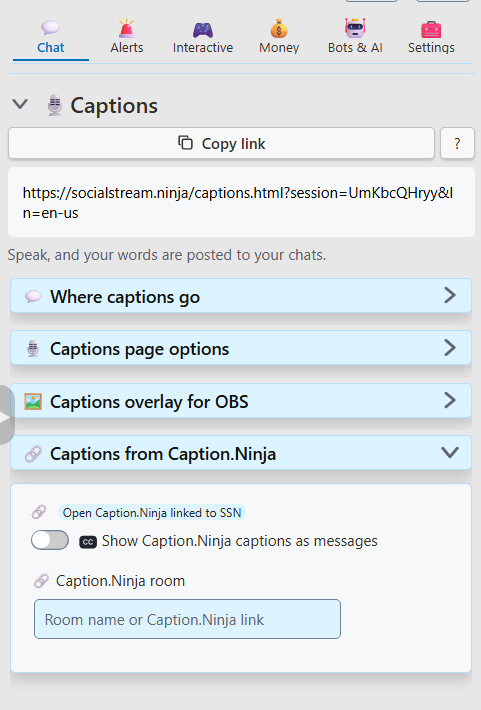
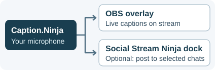

# Post Caption.Ninja captions to your stream chat

Speak into Caption.Ninja as usual. Social Stream Ninja (SSN) posts each finished sentence to your chats, from your own account.

## 1. 🔗 Link Caption.Ninja

Switch SSN on and open your chats as you normally do. On its **Chat** tab, open **Captions**, then **Captions from Caption.Ninja**, and click **Open Caption.Ninja linked to SSN**. Allow microphone access on the page that opens.

The first time, also tell SSN that your captions may be posted: under **Captions**, open **Where captions go** and click **Post to my chats**. It asks once.

## 2. 🎙️ Check your first caption

Say a short sentence, then pause. Your words appear in Caption.Ninja and are posted to your chats. The **Social Stream Ninja** line on the Caption.Ninja page says where they went, for example **posting to twitch, youtube**.

To show live captions on stream, use the **overlay link** from the Caption.Ninja page in OBS. Keep the microphone page address private.

## 3. 💬 Choose where captions go (optional)

Every connected chat is the default. To change that, in SSN, under **Captions**, open **Where captions go**:

- **Only some chats:** choose a chat from **Select source** and click **Add**. Repeat for each one.
- **Fewer posts:** increase **Seconds between posts**.
- **Another language for one chat:** under **Translate for a chat**, choose the chat and the language and click **Add**. SSN translates from the language you speak in Caption.Ninja.
- **Not in chat at all:** turn on **Dock only, do not post to chat**. Your captions then appear straight in the SSN dock.

## Other setups

Keep a custom Caption.Ninja link you already use

1. Select **Copy ID** on SSN's **Chat** tab.
2. Add `&ssn=YOUR_SSN_SESSION_ID` to your existing microphone page address. Replace the placeholder with the ID you copied. If your SSN session has a password, also add `&ssnpassword=YOUR_PASSWORD`.
3. Press Enter and continue from **Check your first caption** above.

Display a room in SSN without posting to chat

In SSN, under **Captions**, open **Captions from Caption.Ninja**. Turn on **Show Caption.Ninja captions as messages** and paste the overlay link into **Caption.Ninja room**. When it says **Connected**, the room's captions appear in the dock and overlays. This option works with public relay rooms, and never posts to chat.

To translate a public room for your SSN overlay, open **Bots & AI → Auto Translate** in SSN and choose **Free built-in (Mozilla)** under **Translator**.

